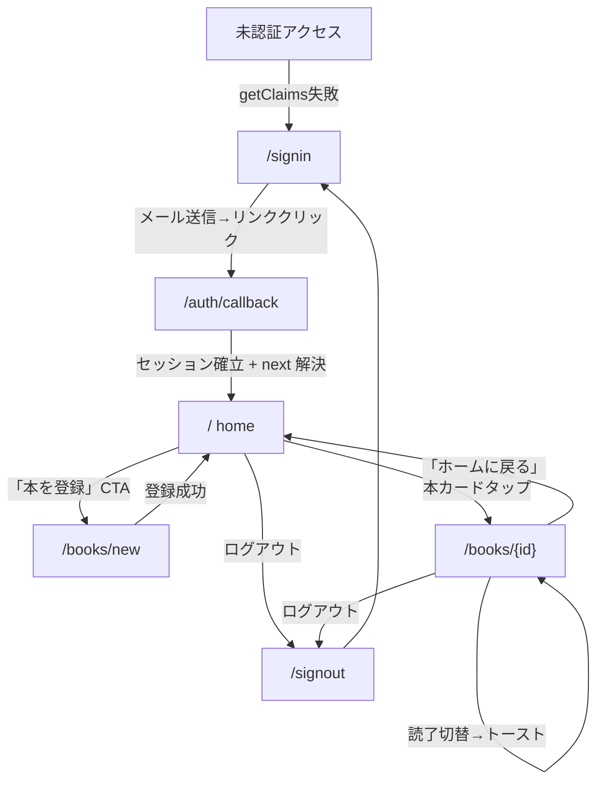

# StoryMapper 画面遷移マップ v1（たたき）

- 作成日: 2026-05-15 (Week 2 Day 7)
- 統合元: Day 6 (2026-05-14) UX設計確定事項 / α版スコープ (2026-04-28確定) / データモデル v1 (2026-04-27確定) / ADR-0001/0003/0005(ドラフト含む)
- 位置づけ: α版実装の指針となる画面構成・遷移・各画面の責務を確定する文書
- 状態: **本ファイルは Cowork 上のたたき**。本人レビュー後、storymapper リポへ取り込み(格納先候補は §9 参照)
- 寝かせ論点(Day 7 再判断): §4 にまとめた

---

## 1. α版画面一覧

| URL | 責務 | 主要表示要素 | 主要入力 | 主データソース | 実装状況 |
|---|---|---|---|---|---|
| `/signin` | マジックリンクサインイン | メール送信フォーム / 送信完了表示 | email | (auth) | ✅ 実装済 (Day 5) |
| `/auth/callback` | マジックリンク受け取り | (即時遷移、エラー時のみ表示) | code, next | supabase.auth | ✅ 実装済 (Day 5) |
| `/signout` | ログアウト Server Action | (即時 redirect /signin) | - | supabase.auth | ✅ 実装済 (Day 5) |
| `/` (home) | 本一覧、登録動線 | 本カード一覧 / 「本を登録」CTA / ログアウト | - | books + reading_progress | 🟡 雛形のみ(認証済表示+ログアウトのみ) |
| `/books/new` | 本登録 (UC0) | タイトル/著者/最初のシーン名 | title, author, first_scene_name | 5 INSERT | ✅ Server Action完成 (Day 4)、本番マージ未 |
| `/books/{id}` | 本詳細 (UC1/UC2/UC3 統合、reading/finished モード兼用) | 現在シーン / シーン一覧 / メモ / キャラ即参照 / 読了切替 | シーン操作・メモ・ブックマーク・読了 | books, scenes, memos, characters, character_states, reading_progress | ❌ 未実装(Week 3 着手) |

### α版スコープ外(枠のみ意識)

| URL | 責務 | 扱い |
|---|---|---|
| `/select` | 「他人の本」選択 | α版スコープ外。home メニューに将来枠を残す想定 (ADR-0005 D5) |
| `/bookreview/{id}` | 他人の本レビュー | β以降 |

---

## 2. 遷移図

設計ノート:
- 本登録成功後の遷移先は当面 home に戻す(`/books/{id}` 直行は Week 3 で再検討、Day 4 引継ぎ事項)
- ログアウトは home / book詳細 の両方からアクセス可能(常時表示の必要はない、メニュー経由想定)

---

## 3. 画面詳細

### 3.1 `/` (home)

- 責務: 認証済ユーザーのトップ。本一覧と登録動線
- 表示要素:
  - 本カード一覧(1リスト + 状態バッジで reading/finished を区別、Day 7 判断)
  - 「本を登録」CTA(主要アクション、目立たせる)
  - ログアウト(副次、メニュー経由想定)
- データソース: `books WHERE user_id = auth.uid()` + `reading_progress` JOIN(mode / current_scene_id 取得)
- 空状態UI: 0冊なら「最初の1冊を登録しよう」CTA を全面表示(オンボーディング設計と整合)
- UC接続: UC1/UC2/UC3 すべての入口
- 実装状況: 雛形のみ。Week 3 で本一覧表示とCTA配置を実装

### 3.2 `/books/new` (UC0)

- 責務: 本登録、最初のシーン作成
- 表示要素: タイトル/著者/最初のシーン名(任意) のフォーム
- 入力: title (1-200), author (1-100), first_scene_name (任意, 空なら「シーン1」自動生成)
- データソース: 5 INSERT(books → scenes (order_key='a0') → labels (type='chapter') → scene_labels → reading_progress (mode='reading'))
- 補償: どこで失敗しても books.delete() の CASCADE で巻き戻し
- 実装状況: Server Action 完成(Day 4 / 5/12)、本番マージは Week 3 頭

### 3.3 `/books/{id}` (UC1/UC2/UC3 統合画面)

α版で最も重い画面。**reading_progress.mode によりビューが切り替わる**(reading / finished)

#### 3.3.1 reading モード(初回読書 / 復帰読書中)

表示要素:

- **現在シーン領域**(画面の主役):
  - シーン名(タップで編集)
  - 現在シーンに紐づくメモ一覧(時系列)
  - ブックマーク(is_bookmark=true のメモ)を視覚区別
- **シーン進行コントロール**:
  - 「前のシーン」「次のシーン」矢印ボタン
  - シーン一覧(横スクロール or 折りたたみ、現在位置ハイライト)
  - シーン挿入「+」ボタン(α版実装確定 — UX をユーザー検証で評価する戦略判断、Day 7 判断)
  - シーン削除(紐づき無しのみ可能、案Z。α版実装確定)
- **クイック入力**:
  - メモ追加(自由記述、現在シーンに紐づく)
  - ブックマーク(ワンタップ + 本文同時入力UI、**本文必須・空欄送信不可**。α版本確定 = 2026-05-19 判断5 確定)
    - **✅ ADR-0005 D7.1 案A 採用で確定(2026-05-19, Week 3 Day 4)**: 本ライフサイクルでは「本文空のブックマーク」を構造的に存在させず、ADR-0005 D7.1 の暗黙シグナルは「明示フラグ(`memos.is_public_eligible` 等)」での代替に方針変更。詳細は ADR-0005 D7.1 (commit `222b260`) 参照
- **キャラ即参照**(常時アクセス、モーダル / サイドパネル / FABのいずれか。Week 3 で詳細決定):
  - キャラ一覧 → タップで初登場シーン / 最新state(居場所・目的・所属) / 関連メモ
  - ネタバレフィルタ: current_scene_id 以前のみ表示
- **読了ボタン**(確認ダイアログあり)

ネタバレ制御:
- visible_scenes / visible_memos / visible_characters / latest_visible_character_states ビュー経由(security_invoker=true、ADR-0003)
- X方式採用により「未来シーン」が構造的にほぼ存在しない → 実質素通し、特殊ケース(将来観測の事実をメモに書いた等)の防御として機能

シーン進行ルール:
- 進行可否: 現在シーンにメモ1件以上(ブックマーク含む) **OR** シーン名手動入力 → 空シーン連打防止
- 戻り方: シーン一覧タップ + 矢印ボタン(両方提供)
- 戻った後の「進む」: 既存次シーンへ移動、新シーン作成は末尾のみ

視点切替対応:
- B (POVキャラ): α版は構造化せず、メモ本文に自由記述
- C (観測時点): observed_in_scene_id = scene_id の簡易運用、UI上は意識しない

#### 3.3.2 finished モード(読了後)

表示要素:
- 全シーン一覧(可視・編集可、ネタバレフィルタOFF)
- 全メモ可視
- 全キャラ最新state可視
- ~~「もう一度読みたい」ボタン~~ β持ち越し(Day 7 判断 — α版テストで現実発火する確率低い、無くても困らない)
- 「読了取消」(本詳細メニュー、確認ダイアログあり)

挙動:
- 読了後もシーン追加可能、current_scene_id 自動進行
- 「中断」UI は持たない('reading' / 'finished' の2値のみ)
- 読了後動線: 本詳細にとどまる + トースト(「読了おめでとう」程度)。サマリー画面はβ以降

#### 3.3.3 共通要素

- 「ホームに戻る」リンク
- ログアウト(メニュー経由)
- データソース: books, scenes, memos, characters, character_states, reading_progress, scene_labels (章ラベル)
- 実装状況: ❌ 未実装(Week 3 着手、§7 の優先度参照)

---

## 4. 寝かせ論点(Day 7 判断結果)

### 論点1: シーン挿入/削除を α版で実装するか → **挿入・削除ともα版実装で確定**
- 判断: 挿入は α版で実装する。「ここの UX はユーザーに問う必要がある」(makimaki 判断、2026-05-15)
- 削除は Day 6 時点の決定(案Z = 紐づき無しのみ可能)を維持
- Claude 提案(挿入をβ持ち越し)は却下。理由は α版でユーザー検証する戦略価値の方が、order_key 運用コストを上回るとの判断
- 影響: §7 実装優先度の 8番タスクが α版 必須スコープに確定

### 論点2: 「もう一度読みたい」ショートカット → **β持ち越しで確定**
- 判断: Claude 提案を採用、β持ち越し
- 影響: §3.3.2 から削除済み、§5 UC3 達成基準から削除

### 論点3: 「ひとくぎりの感覚」読了サマリー画面
- β以降。寝かせ不要(β計画時に再開)

### 判断4(新規): Week 3 実装ターゲット範囲 → **保留中、別途議論**
- §7 の実装優先度 1-8 のうち、Week 3 でどこまでをターゲットにするか
- 議論の論点: Week 3 で確保できる実働日数 × 各タスクの所要見積 × 7月末 MVP α版 マイルストーンとの整合
- 議論タイミング: Week 3 プラン確定時(推定 5/16 土)
- 暫定: 1 (Day 6 繰越分の決着)は Week 3 Day 1 で必ず実施、それ以降は議論次第

### 判断5(新規): メモのライフサイクル設計(ADR-0005 D7.1)→ **確定(2026-05-19 Week 3 Day 4):案A 採用**
- 画面遷移マップ §3.3.1 ブックマーク仕様(本文同時入力UI)と ADR-0005 D7.1 暗黙ルール(空ブックマーク=非公開シグナル)の矛盾は **案A 採用** で解消
- **採用理由**: α版コア仮説「読書中断族の整理ニーズ」検証に集中するため、「本文空ブックマーク」体験はα版検証スコープから外す。Makimaki 判断「整理価値メインに振る、空ブックマーク自体の検証に現段階で価値を置いていない」(2026-05-19 議論)
- **影響**:
  - §3.3.1 ブックマーク仕様を本確定(本文必須、空欄送信不可)
  - α版整理価値提供は `/books/{id}` reading 画面に集約(独立した整理画面はβ以降、§8 補記参照)
  - β拡張時の公開対象判定は新規フラグ追加方式に変更(`memos.is_public_eligible` 等、ADR-0005 D7.1 詳細参照)
- **参照**: ADR-0005 D7.1 (commit `222b260`)、memory `project_storymapper.md` の「Week 3 Day 4 進捗(2026-05-19): 判断5 確定」、Cowork `storymapper_decision5_d7_1_discussion_points_draft.md`(議論論点リスト)

---

## 5. 主要UC再確認(α版)

| UC | 主担当画面 | 達成基準 |
|---|---|---|
| UC0 本の登録 | `/books/new` | 5 INSERT 整合、シーン1自動生成、補償削除 |
| UC1 復帰時の現状参照 | `/books/{id}` reading | 現在シーン + キャラ即参照で「いま誰が何してるか」を5秒以内に想起 |
| UC2 状態変化をサッと入力 | `/books/{id}` reading | クイック入力 + ブックマーク、3タップ以内 |
| UC3 読了後の経路俯瞰 | `/books/{id}` finished | 全シーン可視 + 編集可能(「もう一度読みたい」はβ持ち越し) |

---

## 6. データモデル整合性チェック

- 本マップで参照する全テーブル/ビューはデータモデル v1 (2026-04-27確定) で対応可能
- ADR-0005 非破壊原則と整合: α版実装中は v1 に ALTER 不要
- security_invoker=true ビュー継続使用(ADR-0003)
- α版で新規テーブル追加なし → ADR-0004 (GRANT規約) は α版実装に影響しない(規約自体は Week 3 で起票)

---

## 7. 実装優先度(着手順、案)

> **Week 3 でどこまでをターゲットにするかは「判断4」として別途議論する(§4 参照)**

1. main マージ + 本番デプロイ + `/books/new` 本番動作確認(Day 6 繰越分の決着)
2. `/books/{id}` reading モード骨格 — 現在シーン表示 + シーン進行(進/退のみ)
3. メモ作成 + ブックマーク
4. シーン進行可否判定 + 戻り方UI
5. キャラ即参照(モーダル/サイドパネル選定 + 実装、別タスク)
6. 読了切替(reading↔finished、確認ダイアログ)
7. finished モードのビュー切替
8. シーン挿入/削除(α版実装確定、論点1)

ブロック化: 1 単独 / 2-4 まとまり / 5 単独 / 6-7 まとまり / 8 単独
Claude 推奨ターゲット案(議論材料): 1-4 までを Week 3 のターゲット。理由は 5(キャラ即参照)が UI 設計で時間かかる読み、8(挿入/削除)は order_key 運用検証で別途時間が要る読み

---

## 8. 未確定事項(Week 3 以降で扱う / 本マップでは触れない)

- キャラ即参照UI の具体形(モーダル / サイドパネル / FAB位置)
- メモ入力UI のインタラクション(モーダル / インライン / FAB)
- シーン名編集のインタラクション(タップで即編集 / メニュー経由)
- 章ラベル付与UI(α版は章ラベルのみ使用)
- オフライン対応の組込タイミング(Week 4以降)
- Capacitor 統合(Phase 2 着手前 = 2026/8前後)
- AI整理支援(β以降、ADR-0001 + Tutorial Ch4で学んだ XML分離パターンが下地)
- 独立した整理画面・サマリー画面(β以降確定。判断5 確定により α版整理価値は `/books/{id}` reading 画面に集約、2026-05-19。α版ユーザー検証フィードバックを元に β以降の整理画面設計を決める)

---

## 9. 確定後の取り扱い

- 確定タイミング: Day 7 (2026-05-15) 中に寝かせ論点1-2 を判断済 → §3-§5 反映済 → **「v1 確定」**(判断4 = Week 3 ターゲット範囲のみ別途議論として保留)
- 格納先: **B案 `storymapper/docs/design/screen-map-v1.md` に確定**(2026-05-15 Day 7 判断)
  - 理由: 今後 UI 設計ノート / 用語集 / シーン管理仕様 などが増える想定で design/ ディレクトリを早めに切る
- 取り込みは PowerShell から(claudework_edit_policy 準拠)
- 取り込み時の補足: ADR-0005 のコミットと同タイミングでまとめて取り込むと git 履歴が綺麗
